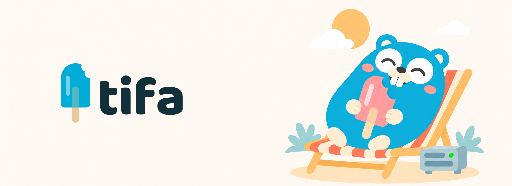

<h1 align="center"></h1>

<p align="center"><b>Full-stack Go web framework with React pages.</b></p>

<p align="center">
  <a href="./README.zh-CN.md">简体中文</a> ·
  <a href="docs/start/app.md">Writing an app</a> ·
  <a href="docs/build-and-deploy/build.md">Build and run</a> ·
  <a href="docs/build-and-deploy/dev.md">Dev server</a> ·
  <a href="examples/shop">Example app</a>
</p>

<p align="center">
  <a href="https://x.com/liustack"></a>
  <a href="https://pkg.go.dev/github.com/liustack/tifa"></a>
  <a href="go.mod"></a>
  
  <a href="LICENSE"></a>
  
  
</p>

Write the backend in Go and the pages in React. Tifa renders React inside the Go process and compiles the whole site into one executable, which you copy to a small VPS and run, or put there with `tifa deploy`. No Node in production, no process manager, no reverse proxy, no Redis.

It is for Go developers whose business logic and data already live in Go, and for indie hackers and startup teams who want a real React app without running a stack beside it.

> Tifa is very early. APIs will change, and many compiler optimizations are not done yet.

## Why it exists

I wanted to ship a small product on TanStack Start. My other VPSes were full, Black Friday was still weeks away and I did not feel like buying another one, so I dug out an old box with 1 CPU and 1 GB of RAM. I had Codex set up the usual stack in one go: nginx, Node.js, PM2, TanStack Start, Redis, BullMQ, cron and SQLite.

It did not really run. It crawled.

So I started hacking on Tifa. Once it is done, deploying should mean copying one Go binary to the VPS, and that is it.

| On a 1 CPU / 1 GB VPS | The usual stack | With Tifa |
| :-- | :-- | :-- |
| Reverse proxy and certificates | nginx + certbot | The Go HTTP server in the binary, which gets its own Let's Encrypt certificate and speaks HTTP/2 |
| Runtime and process manager | Node.js + PM2 | One Go executable |
| React SSR | TanStack Start | TanStack Router, rendered inside the Go process by [beastjs](https://github.com/liustack/beastjs), the fastest pure Go JavaScript engine for rendering React |
| Cache | Redis | An in-process render memo for pages, a CDN in front if you want one, plus whatever you keep in Go memory |
| Queues and scheduled jobs | BullMQ + cron | Goroutines you start in `OnStart` |
| Database | SQLite | SQLite, with [the fastest pure Go SQLite driver](https://github.com/liustack/sqlite), so CGO stays off |
| Backups | Litestream, or a cron job that copies the file | Every commit copied to Cloudflare R2 about a second later, from inside the app, and restored on a new machine at its first start (`db.backup`) |

I still do not know what to call it. A React SSR framework with no Node runtime? A React SSR framework with a Go backend? Both sound a little unhinged. Under the hood it is Go, [beastjs](https://github.com/liustack/beastjs) (a pure Go JavaScript engine), and TanStack Router.

Go + React SSR has been tried before: [go-starter-kit](https://github.com/olebedev/go-starter-kit) is archived, and [go-react-ssr](https://github.com/natewong1313/go-react-ssr) stopped in 2024 and renders through C QuickJS with CGO. Tifa is a finished framework around the same idea: Go routing, data loading, caching and background jobs, React rendered by a pure Go engine with CGO off, TanStack Router in the browser, and `tifa deploy`, all in one executable.

## What it looks like

One folder per page. Go loads the data, React shows it:

```go
// app/projects/project+/orders/order+/route.go  →  /projects/{project}/orders/{order}
func Load(c *tifa.Ctx) (orders.Order, error) {
	return orders.GetOrder(c.Param("project"), c.Param("order"))
}
```

```tsx
// app/projects/project+/orders/order+/page.tsx
import { page, type PageData } from './route.gen'

export default function OrderPage() {
  const order = page.useLoaderData() // typed from the Go return value
  return <h2>{order.id}</h2>
}

// title and meta tags are written into the HTML on the server
export const head = ({ loaderData }: { loaderData?: PageData }) => ({
  meta: [{ title: `Order ${loaderData?.id}` }],
})
```

```sh
go get -tool github.com/liustack/tifa/cmd/tifa
go tool tifa dev     # hot-reloads components, restarts on Go changes
go tool tifa build   # bin/<app>, with the frontend embedded
go tool tifa check   # analysis, vet, tests and the TypeScript check in one go
```

## Highlights

- **One file to deploy.** Pure Go, `CGO_ENABLED=0`, cross-compiles like any Go program. The browser bundle, styles and server renderer are embedded in the executable.
- **Live on every push.** `tifa deploy setup` sets up the server, Cloudflare and GitHub Actions in one command. After that every push is checked and goes live, and a release that fails its health check rolls back by itself. See [Deploying](docs/build-and-deploy/deploy.md#deploy-with-tifa-deploy).
- **Real HTML on the first request.** Go runs the page's `Load` and every `Layout` function first, then renders React to complete HTML inside the process with beastjs, a pure Go JavaScript engine. Search engines and link previews see the content, title and meta tags. Each page renders whole in one pass: there is no streaming and there are no React Server Components.
- **Your frontend tools keep working.** Vite, Tailwind and shadcn work as usual on your machine. The server runs one Go file and never installs Node.
- **Types from Go to React.** The TypeScript type of each page's data is generated from what its Go `Load` returns.
- **Mistakes caught at build time.** Duplicate paths, a Layout reading a parameter it does not own, a `Load` result that cannot become TypeScript: the build stops and names the file and line.
- **Fast after the first page.** TanStack Router takes over in the browser. Each navigation is one request for data, and Layouts that are already loaded are not fetched again.

## One small server is enough

The **[render memo](docs/reference/memo.md)** is on for every page, signed-in ones like a cart or a bill included. Every request fetches fresh data first and reuses the last render only when nothing changed, so a page is never stale. A render is reused only for the same data and the same session, so one person's page never reaches another. The app writes no caching code.

Whole visits, played back from real browsers on the example shop: shoppers, staff and crawlers on one server at once, every server as shipped and warmed up with the same visits first (2026-11-18).

Throughput at 8 concurrent sessions with no pause between pages, the median of 3 rounds:

| | Page views/s | Full loads/s | Client navigations/s |
| :-- | --: | --: | --: |
| Tifa | 118.8 | 38.3 | 80.5 |
| Next.js | 28.3 | 9.1 | 19.2 |
| TanStack Start, uncompressed | 94.7 | 30.5 | 64.2 |
| For reference: Tifa with the render memo off | 78.0 | 25.1 | 52.8 |
| For reference: TanStack Start with gzip | 64.5 | 20.8 | 43.7 |
| For reference: Next.js with prefetch off | 61.7 | 19.9 | 41.8 |

A full load is a request the server answers with a whole page: the landing of a visit, and a search or another action that loads a page. A client navigation is one the router answers with data alone. Every server plays the same visits, so about a third of the page views of every row are full loads.

Latency at 2.75 visits a second, half of what Next.js sustains, one round:

| | Full load P50 / P99 | Client navigation P50 / P99 |
| :-- | --: | --: |
| Tifa | 31.3 / 65 ms | 2.3 / 30 ms |
| Next.js | 45.1 / 125 ms | 18.0 / 118 ms |
| TanStack Start, uncompressed | 27.5 / 62 ms | 3.4 / 31 ms |
| For reference: Tifa with the render memo off | 36.5 / 69 ms | 2.6 / 37 ms |
| For reference: TanStack Start with gzip | 40.7 / 107 ms | 4.3 / 37 ms |
| For reference: Next.js with prefetch off | 36.2 / 108 ms | 7.7 / 59 ms |

The first three rows are the frameworks as shipped. Each reference row changes one setting, to show what that default costs or buys. Versions: Tifa v0.1.0, slowjs v0.31.6, Next.js 16.4.6, TanStack Start 1.169.3, Node 24.13.0. Each server on one core of a Google Cloud `t2d-standard-4` VM (AMD EPYC 7B13). [Whole visits](docs/reference/performance.md#whole-visits-to-the-shop-2026-11-18) has the mix, what each default costs and what the numbers mean.

## Start an app

You need Go 1.27 and Node 20.19 or 22.12 and later (what Vite 8 asks for). The npm that comes with Node is enough, and `tifa new` uses pnpm when you have it. Pages need React 19.3 or later, which `tifa new` installs. Node only builds the front end: the program you deploy never needs it. `tifa new`, `tifa dev`, `tifa check` and `tifa build` run on Windows (10 1809 and later), and the program they build is `bin\<app>.exe`.

```sh
go run github.com/liustack/tifa/cmd/tifa@latest new myapp
cd myapp
go mod tidy
npm install          # or pnpm install
go tool tifa dev     # http://127.0.0.1:9527
```

On a machine that has never built a Tifa app, `go mod tidy`, `npm install` and the first `tifa dev` also download Go and npm packages, which can take a few minutes. The compile itself takes about 7 seconds on an Apple M4 (an empty build cache, the whole app). Later builds use the caches.

The install also runs `go tool tifa gen` (the `prepare` script of `package.json`), which writes the types of `.tifa/` that your editor reads. Open the editor after it: before, the imports of `./route.gen` show errors.

`tifa new` writes a small todo list stored in SQLite to replace with your own domain: a home page with a Go `Load`, a `POST` the page calls from the browser, a page per todo, sessions kept in the database, tests, and a GitHub Actions workflow that runs `go tool tifa check`. The module path is the folder name unless you pass `--module example.com/myapp`.

## Try the example

[examples/shop](examples/shop) is a small shop in two halves: an order workbench for the owner (order list, order details, a shipping form, sales stats with charts) and a storefront for customers in Chinese and English (product search and filters, product pages, a cart, a checkout form and a journal in Markdown). You need Go 1.27, Node 20.19 or 22.12 and later, and pnpm:

```sh
cd examples/shop
pnpm install --frozen-lockfile
go tool tifa build
./bin/shop           # http://127.0.0.1:9527
```

## Use it with a coding agent

`tifa new` gives every app two things for coding agents, both from the Tifa version the app uses:

- `AGENTS.md`, notes most coding agents read on their own: the conventions, the commands, and where the docs of this version are.
- The Tifa skill ([skills/tifa](skills/tifa)) in `.claude/skills/tifa/`, with more detail and links to the docs. Claude Code, Cursor and GitHub Copilot find it there. Codex and Gemini CLI look in `.agents/skills/`: copy the folder there, and again after an upgrade.

`go tool tifa upgrade` writes both again when it moves the app to a newer Tifa. `go tool tifa agents` does it without an upgrade, also in an app that has neither yet:

```sh
go tool tifa agents
```

More in [Use Tifa with a coding agent](docs/start/agents.md).

## Documentation

| Doc | Read it when |
| :-- | :-- |
| [Tutorial](docs/start/tutorial.md) | You are new to Tifa and want to build a small app from the first folder to a running program |
| Guides: [forms](docs/guides/forms.md), [uploads](docs/guides/uploads.md), [sign-in](docs/guides/sign-in.md), [database](docs/guides/database.md), [background work](docs/guides/jobs.md), [email](docs/guides/email.md), [languages](docs/guides/i18n.md), [search engines and language models](docs/guides/seo.md), [streaming](docs/guides/streaming.md), [values from the environment](docs/guides/environment.md), [logs](docs/guides/logs.md) | Adding a common feature and you want a tested way to do it |
| [Philosophy](docs/start/philosophy.md) | You want to know why a Tifa app is organized the way it is |
| [Structuring an app](docs/start/structure.md) | Deciding where domain code, storage and shared resources go, and which way packages may import each other |
| [Use Tifa with a coding agent](docs/start/agents.md) | Working on an app with Claude Code, Codex, Cursor or another coding agent |
| [Writing an app](docs/start/app.md) | Laying out folders, how they become URLs, and which doc to read next |
| The parts of an app: [routing](docs/pages-and-data/routing.md), [layouts](docs/pages-and-data/layouts.md), [loading data](docs/pages-and-data/loading-data.md), [method handlers](docs/pages-and-data/handlers.md), [links and navigation](docs/pages-and-data/navigation.md), [head](docs/pages-and-data/head.md), [errors](docs/pages-and-data/errors.md), [render switches and caches](docs/pages-and-data/ssr-and-cache.md), [server render](docs/pages-and-data/server-render.md), [styles](docs/pages-and-data/styles.md), [hooks](docs/pages-and-data/hooks.md), [testing](docs/pages-and-data/testing-apps.md), [testing pages](docs/pages-and-data/testing-pages.md) | Writing the Go and React code of a route, Layouts, 404 pages, head tags, `Cache` for CDNs, what the server render has, CSS, startup code, Go tests and tests of pages |
| [Sessions](docs/pages-and-data/sessions.md) | Signing users in and out, keeping sessions in Redis or SQL, or showing who is signed in |
| [Content](docs/pages-and-data/content.md) | Keeping a blog or docs as Markdown files and reading them in Go |
| [Build and run](docs/build-and-deploy/build.md) | Building the program with `tifa build`, building it for another system, or checking what to ship with it |
| [Generated files and app setup](docs/reference/generated-files.md) | You want to know what `tifa build` generates and how the program answers requests |
| [Dev server](docs/build-and-deploy/dev.md) | Running `tifa dev` locally, or a change did not reload |
| [Deploying](docs/build-and-deploy/deploy.md) | Putting the program on a server or in a container, or behind a CDN or proxy |
| [Configuration](docs/build-and-deploy/config.md) | Where settings come from: `tifa.yaml`, flags, the environment and `.env`, and the options of your app |
| [Settings](docs/reference/settings.md) | Deploying: the port, HTTPS, body limit, VMs, render timeout, the render memo and the Cache-Control of pages with `Cache` |
| [Architecture](docs/internals/architecture.md) | You want to know how a request, `tifa build`, `tifa dev`, the VM pool and the render memo work inside |
| [Render memo](docs/reference/memo.md) | You want to know why pages, signed-in ones included, are reused safely with nothing to set up |
| [Compatibility](docs/reference/compatibility.md) | You want to know whether a Tifa upgrade can break your app, and what stays stable |
| [Performance](docs/reference/performance.md) | You want to know whether a small VPS can carry your traffic |
| [Research studies](docs/studies/README.md) | You want the full method and data behind a number, or to see whether an idea was already tried |
| [Testing](docs/internals/testing.md) | Contributing to Tifa itself |

## Talk to us

Issues are welcome any time: [open one](https://github.com/liustack/tifa/issues/new/choose). Tell us what you built, where it hurt, and what should come next. Follow the liustack WeChat official account, and come find me on X: **[@liustack](https://x.com/liustack)**. What changes in Tifa and what comes next are shared on WeChat and X.

The **liustack** WeChat official account: AI startup opportunities, indie-dev insights, and hands-on AI tooling, delivered as they happen. Scan the QR code in WeChat, or search for "liustack":

<p align="center">
  
</p>

## Contributing

Tifa does not accept pull requests. A framework like this touches the compiler, the bundler, server rendering and developer experience at once, and a change in one pulls on the others. Getting that right takes a lot of context, so every line is written and reviewed by one author. Two ways to help:

- **[Open an issue](https://github.com/liustack/tifa/issues/new/choose).** Bugs, ideas, confusing errors, unclear docs. A clear issue with steps to reproduce helps more than a patch, and issues shape what gets built next.
- **Fork it.** Under MIT your copy is yours to change and publish. [CONTRIBUTING.md](CONTRIBUTING.md) has the notes for working on a fork.

## Star History

<a href="https://www.star-history.com/#liustack/tifa&Date">
 <picture>
   <source media="(prefers-color-scheme: dark)" srcset="https://api.star-history.com/svg?repos=liustack/tifa&type=Date&theme=dark" />
   <source media="(prefers-color-scheme: light)" srcset="https://api.star-history.com/svg?repos=liustack/tifa&type=Date" />
   
 </picture>
</a>

## License

[MIT](LICENSE). A program built with Tifa embeds locale data and time zones from Unicode CLDR, ICU and go-intl, whose notices go with the program when you distribute it, see [docs/build-and-deploy/build.md](docs/build-and-deploy/build.md#notices-to-ship-with-the-program).

The gopher in the banner is a redrawn [Go gopher](https://go.dev/blog/gopher), originally designed by Renee French and used under [CC BY 4.0](https://creativecommons.org/licenses/by/4.0/).
