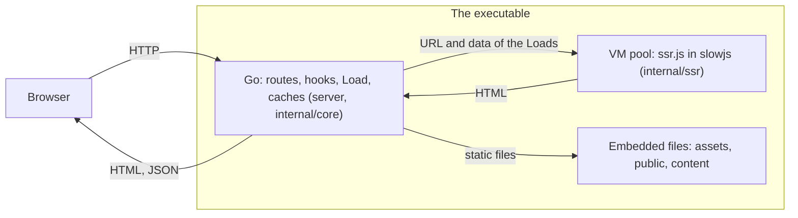
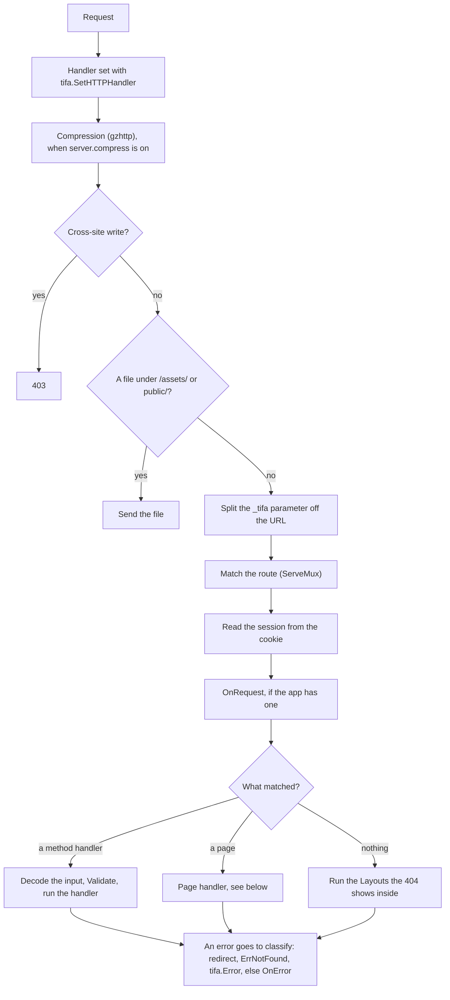
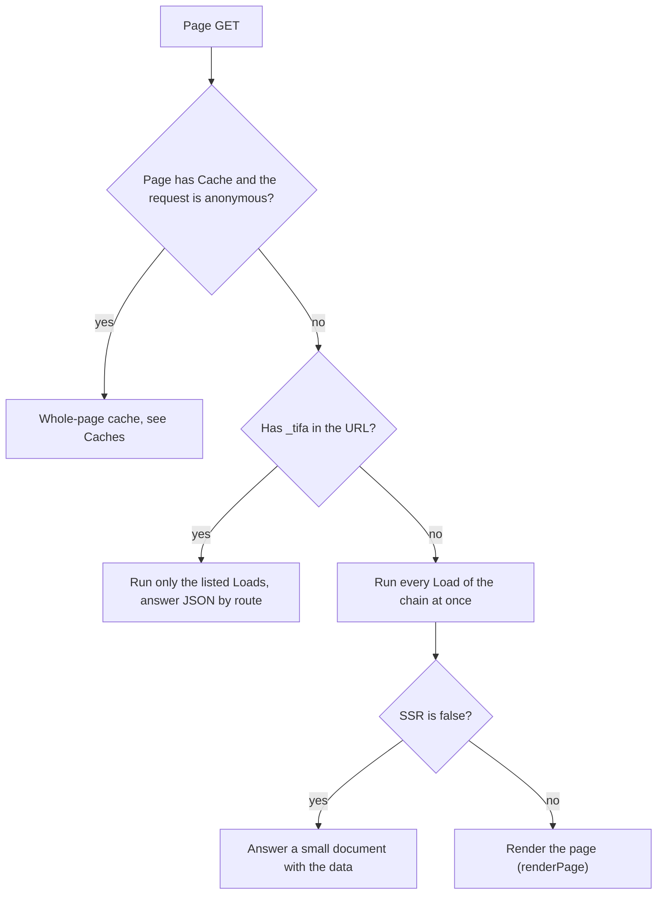
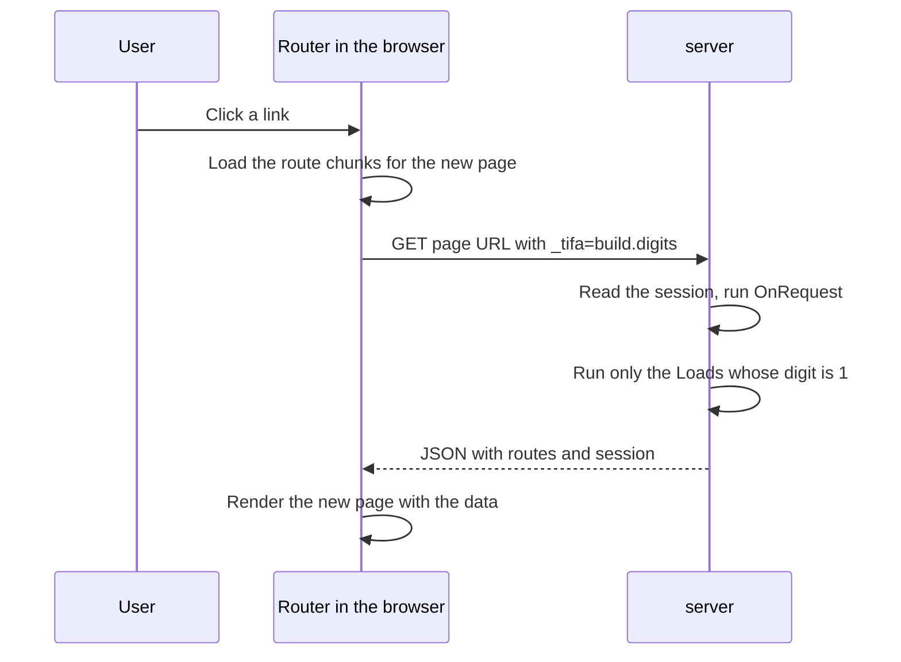
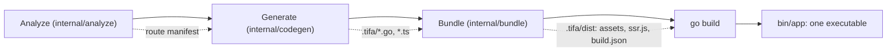
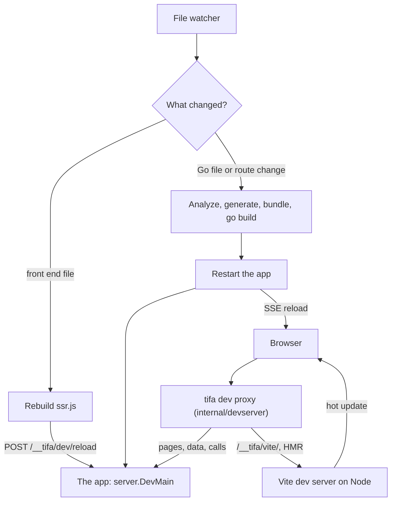
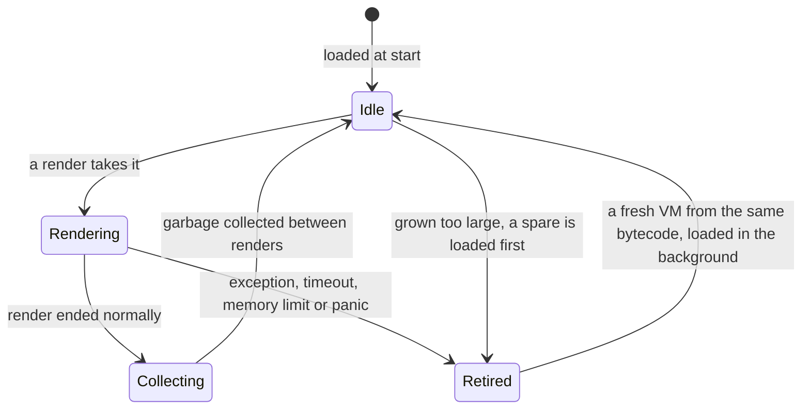
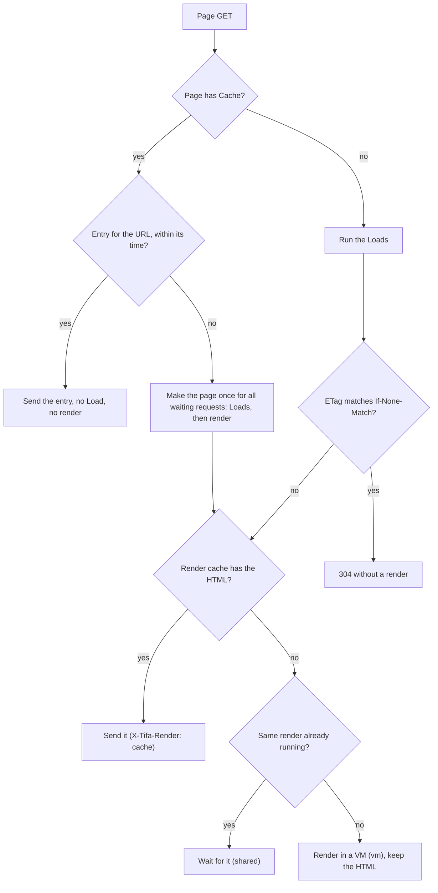

English · [简体中文](architecture.zh-CN.md)

# How tifa works inside

This page is for someone who wants to understand tifa or change it. To write an app, start with [Writing an app](app.md). The diagrams show the steps in order, and each one names the package that does the work.

## The parts

A built tifa app is one executable. Inside it, Go answers every request and calls JavaScript only to turn data into HTML.

| Package | What it owns |
| --- | --- |
| `tifa`, `tifatest`, `content` | The public API. `tifa` is thin: it forwards to `internal/core`. `tifatest` makes a `Ctx` for tests |
| `internal/core` | `Ctx`, errors, the JSON rules, sessions and the session store, the render clock |
| `server` | The HTTP server: routing, `OnRequest`, page and data requests, both caches, compression, HTTPS, cross-site check, graceful stop |
| `internal/ssr` | The pool of QuickJS VMs and the render call |
| `internal/config` | Settings: sources, flags, values and their errors |
| `internal/analyze` | Static analysis of the app's Go code into the route manifest |
| `internal/codegen` | Writes `.tifa/`: the Go main, the route registration, the TypeScript route tree |
| `internal/bundle` | Runs the app's Vite on Node and builds `dist/` |
| `internal/devserver` | The core of `tifa dev`: watching, rebuilding, restarting, proxying |
| `internal/content`, `internal/deverrors`, `internal/testproc` | Content collections, the errors `tifa errors` prints, and the programs tests start |
| `js/runtime` | The TypeScript that runs in the VM and the browser: router, hydration, `tifa/client` |
| `js/vite`, `js/host` | The Vite plugin, and the polyfills the VM needs (crypto, base64, structuredClone and so on) |
| `cmd/tifa` | The command line: `new`, `build`, `dev`, `check`, `routes`, `errors`, `docs` |

## The path of a request

`server.Main` starts the program in this order: read the settings, register the routes, load the content, compile `ssr.js` and prewarm the VMs, run `OnStart`, then listen. A bundle that does not load stops the start, so a broken build never answers a request.

Every request goes through `server.route`:

- `next(c)` in `OnRequest` is the step from `OnRequest` to the route. A route error comes back out through `next`, and the server turns it into an answer only after `OnRequest` returns.
- A page of the whole-page cache is made anonymous before the session is read, so none of the later steps see a cookie.
- A call from a page of an older build gets 409 before the handler runs.

### What a page handler does

`renderPage` makes the input of the VM from the results of the `Load`s, computes the ETag from it, and answers 304 when `If-None-Match` matches. Otherwise it asks the render cache, which renders in the VM pool on a miss. Data goes to the VM as text, and the pool fills it into the page after the VM is free again, so the VM does not copy large JSON. With `server.csp` the render marks the scripts and styles it writes with the nonce of the render, and the pool takes the marks out again and hashes those elements, so the page goes out with a policy that lets only them run (see [Content-Security-Policy](config.md#content-security-policy)).

When a render fails, the server renders again with the error in place of the page (`rescue` in `server/page.go`). If that fails too, Go writes a plain error page.

### Navigation in the browser

After the first page, TanStack Router takes over. It asks Go for data only, never for HTML:

The digits have one place per `Load` or `Layout` on the chain of the URL, and a `1` asks for that one. Data the router still holds is not asked for again. If the build in `_tifa` is not the build of the server, the server answers 409 and the browser reloads the page once. See [Data protocol](build.md#data-protocol).

## What tifa build does

`tifa build` (`cmd/tifa/build.go`) runs four steps. Nothing in them runs the app's Go code.

1. **Analyze.** `analyze.Analyze` loads the app with `golang.org/x/tools/go/packages`, type checks it, and reads the conventions from the syntax tree and the types: the folders, the `Load`, `Layout` and handler signatures, the constants, the hooks, the session type, `content.go`. It collects every rule violation and prints them all with `file:line`. Static analysis only reads, so a failed analysis leaves no `.tifa/` behind.
2. **Generate.** `codegen.Generate` turns the manifest into files in `.tifa/`: `main.go`, which calls `server.Main`, and `tifaapp/app.go`, the application table that the main and the tests of the app use (the Go side), and `routes.tsx`, the `route.gen.ts` modules, `server.ts` and `client.ts` (the TypeScript side). The same manifest gives the same bytes, so unchanged files are not rewritten.
3. **Bundle.** `bundle.App` starts one Node process that runs the app's own Vite with the tifa plugin from `js/vite`. It builds the browser bundle (split per route, content hashed, with `.gz` files) and then the SSR bundle `ssr.js`, which knows the tags of the browser bundle. It also copies `public/` and writes `build.json` with the build ID. An app without pages skips this step and needs no Node.
4. **go build.** `CGO_ENABLED=0 go build` compiles `.tifa/`, which embeds `dist/` with `//go:embed`.

Each program compiles `ssr.js` into bytecode once at start, and every VM loads that bytecode (`ssr.NewPool`).

## What tifa dev does

`tifa dev` runs the same four steps, but keeps the pieces running between changes.

- The browser talks only to the proxy. It sends module and hot update requests to Vite, and everything else to the app.
- A front end change updates open pages through Vite. tifa dev also rebuilds `ssr.js`, and the running app loads it in place without a restart, so `OnStart` does not run again.
- A Go change, or a change of the routes, runs the steps it needs and restarts the app. `.tifa/` content decides whether the route manifest changed, so a change inside a function body skips generation and bundling.
- A failed step keeps the running app, and the error shows in the terminal and on the page. `tifa errors` prints the same errors.
- The app under `tifa dev` stops when tifa dev ends, because it reads a pipe that tifa dev holds (`--lifeline-fd`).

The full table of changes and steps is in [What each change triggers](dev.md#what-each-change-triggers).

## The VM pool

`ssr.NewPool` loads `ssr.vms` VMs before the program listens. A VM renders one page at a time.

- A render waits for an idle VM. At most `ssr.queue_limit` renders wait, each for up to `ssr.wait_timeout`. The first limit reached returns `tifa.ErrSSRBusy`, and the server answers 503.
- A render that ends normally returns its VM. A young garbage collection runs between renders, a full one now and then, and a VM that sat idle gives its free memory back to the system.
- A render that fails in any way, or runs past `ssr.timeout`, or uses up `ssr.vm_memory`, retires its VM. Stopping a render halfway leaves the VM in an unknown state, so it is closed. A new VM loads in the background, retried with a growing delay, and the pool keeps its size.
- A render that ends in a redirect (the router rewrote the URL) is an answer and keeps its VM.
- A VM whose live size grew far past its start size is replaced, with the spare loaded before the old one leaves, so renders never lose capacity.
- Page code cannot catch a timeout or a memory error. No `catch` or `finally` runs for it.

See [Performance](performance.md) for sizing and [config.md](config.md#render-queue) for the queue.

## Caches

Two caches share one LRU of `cache.size` bytes.

- **Render cache.** The key is a hash of the build ID, the SSR bundle, the URL, the data of every `Load`, the session the browser gets and the policy of `server.csp`. The same key always gives the same HTML, so a hit skips the VM. Each request still runs `OnRequest` and its `Load`s, so data is never stale. The HTML is kept with its gzip and zstd forms.
- **Shared renders.** Requests that miss the same key at the same time wait for one render, even when `cache.size` is 0. The render runs in a goroutine that belongs to none of them, so one client leaving does not cancel it.
- **ETag.** It is a hash of the same things as the render key. A matching `If-None-Match` is answered before the cache is asked. The ETag saves the transfer to a browser, and the cache saves the render for everyone else.
- **Whole-page cache.** Only a page with `const Cache` has it. The request is made anonymous, the key is the scheme, host, path and the query without tracking parameters, and an entry lives for `Cache`. A hit runs no `Load` and no render. A miss makes the page once for every waiting request, through the render cache. When making it fails, the old entry is served for up to a day.
- A content entry that reaches its date expires every whole page made before it (`contentChanged`).
- `tifa.ExpirePages` marks the entries of the paths it gets as expired, whatever their host, scheme and query, and drops the makes of those paths under way from the shared ones, so what they read before the call is not kept (`expirePaths`). An expired entry still stands in for a make that fails.
- `tifa.Stats` reads the counts of the pool and the two caches. Renders and cache lookups count with atomics, under no new lock.

Rules for apps are in [SSR and cache](app.md#ssr-and-cache) and [The whole-page cache](app.md#the-whole-page-cache). The answers tifa sends for each case are in [Page requests](build.md#page-requests).
