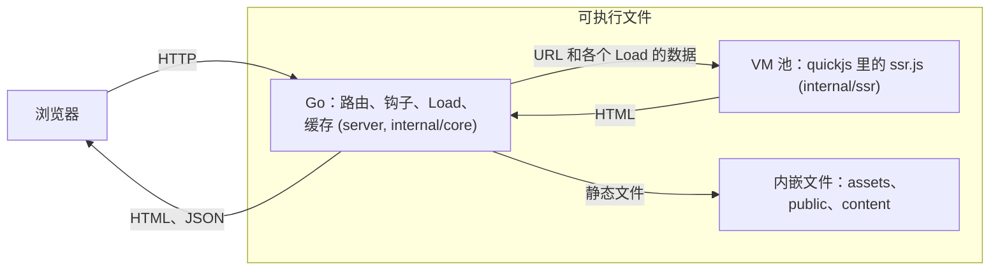
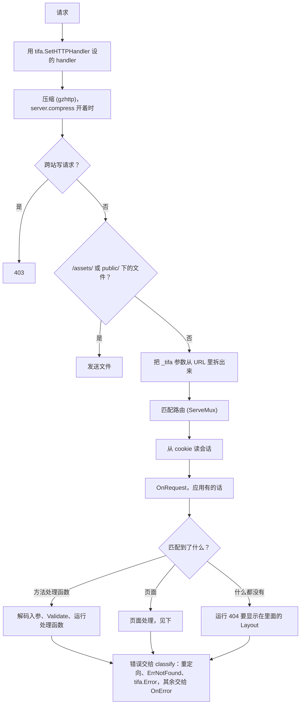
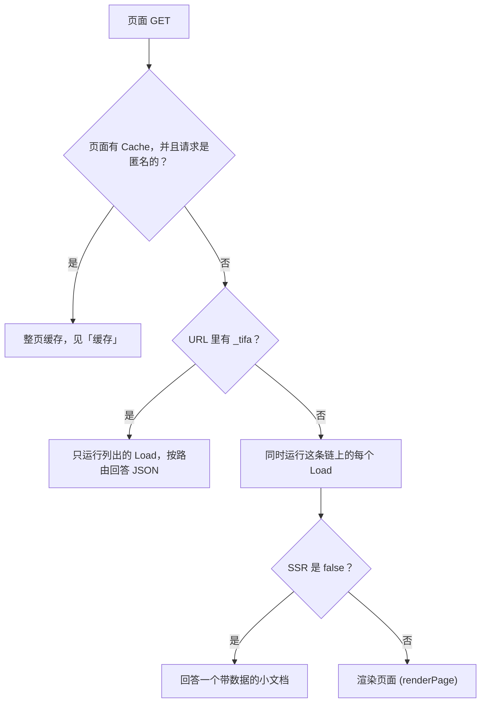
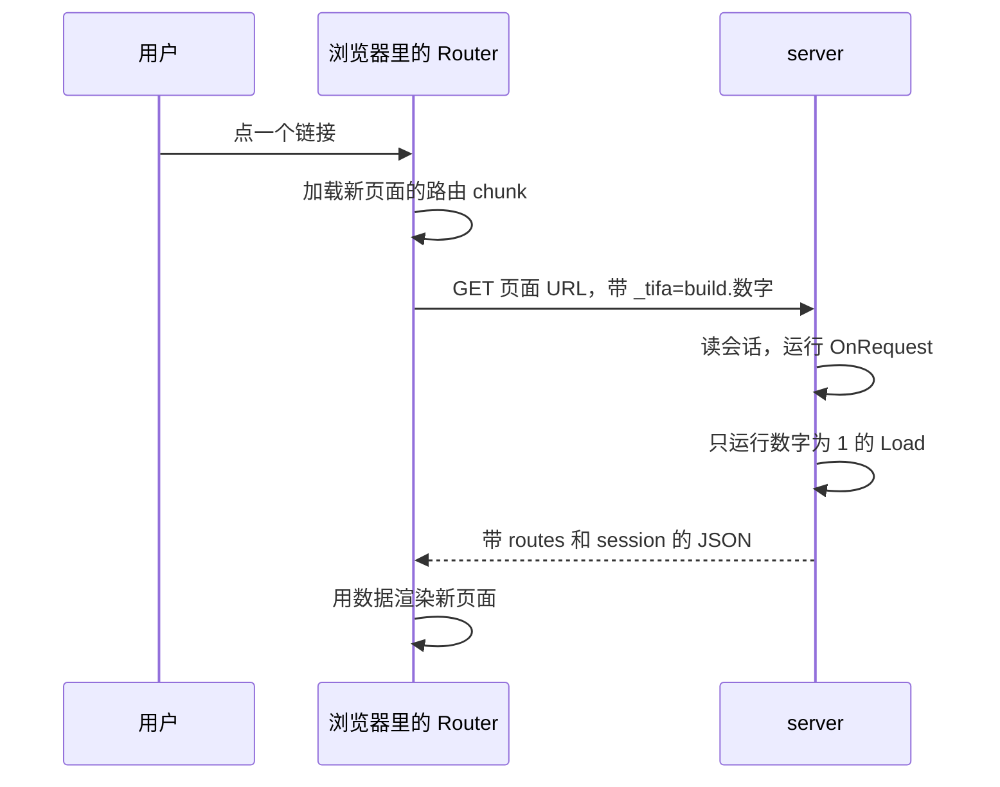
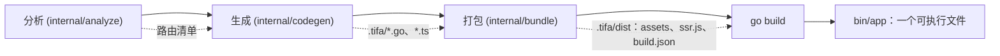
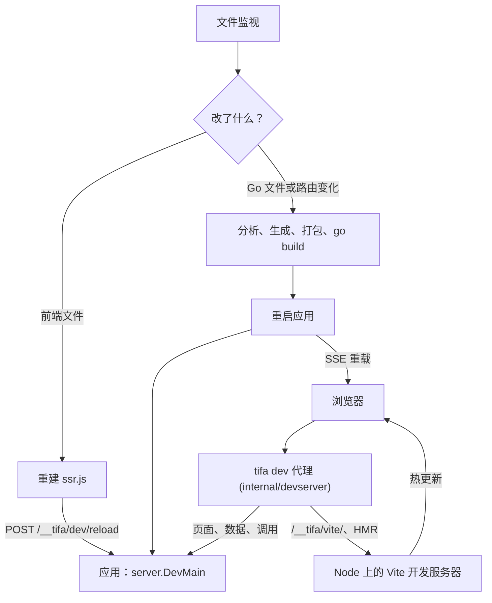
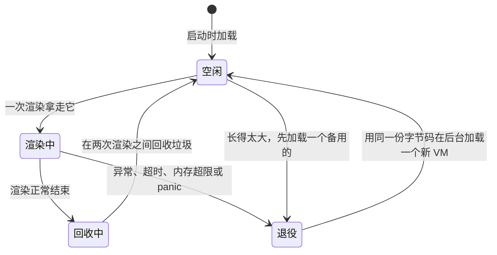
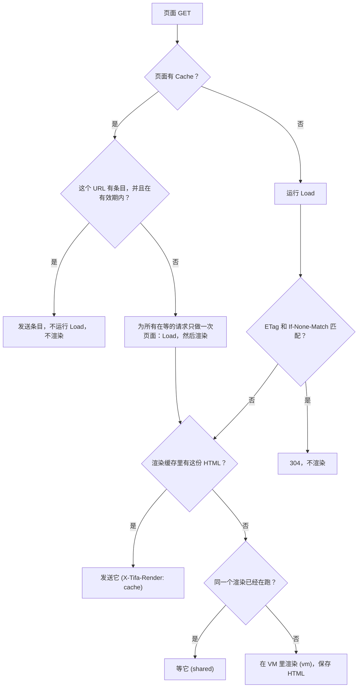

[English](architecture.md) · 简体中文

# Tifa 的内部怎么工作

这一页写给想弄懂 Tifa 或者想改它的人。想写应用，先看[应用怎么写](app.zh-CN.md)。图按顺序画出每一步，并写明每一步由哪个包做。

## 各个部分

构建好的 Tifa 应用是一个可执行文件。里面由 Go 回答每个请求，只有把数据变成 HTML 时才调用 JavaScript。

| 包 | 管什么 |
| --- | --- |
| `tifa`、`tifatest`、`content` | 公开的 API。`tifa` 很薄，只转给 `internal/core`。`tifatest` 为测试造 `Ctx` |
| `internal/core` | `Ctx`、错误、JSON 规则、会话和会话存储、渲染时钟 |
| `server` | HTTP 服务器：路由、`OnRequest`、页面请求和数据请求、两个缓存、压缩、HTTPS、跨站检查、优雅退出 |
| `internal/ssr` | [QuickJS](https://github.com/liustack/quickjs) VM 池和渲染调用 |
| `internal/config` | 设置：来源、命令行参数、值和它们的错误 |
| `internal/analyze` | 把应用的 Go 代码静态分析成路由清单 |
| `internal/codegen` | 写 `.tifa/`：Go 的 main、路由注册、TypeScript 路由树 |
| `internal/bundle` | 在 Node 上跑应用自己的 Vite，构建 `dist/` |
| `internal/devserver` | `tifa dev` 的核心：监视、重建、重启、代理 |
| `internal/content`、`internal/deverrors`、`internal/testproc` | 内容集合、`tifa errors` 打印的错误、测试启动的程序 |
| `js/runtime` | 在 VM 和浏览器里跑的 TypeScript：路由、水合、`tifa/client` |
| `js/vite`、`js/host` | Vite 插件，以及 VM 需要的 polyfill（crypto、base64、structuredClone 等） |
| `cmd/tifa` | 命令行：`new`、`build`、`dev`、`check`、`routes`、`errors`、`docs` |

## 一个请求的路径

`server.Main` 按这个顺序启动程序：读设置、注册路由、加载内容、编译 `ssr.js` 并预热 VM、运行 `OnStart`、开始监听。加载不了的 bundle 会让启动失败，所以坏掉的构建不会回答任何请求。

每个请求都经过 `server.route`：

- `OnRequest` 里的 `next(c)` 就是从 `OnRequest` 走到路由的那一步。路由的错误通过 `next` 返回，服务器等 `OnRequest` 返回之后才把它变成回答。
- 整页缓存的页面在读会话之前就被变成匿名的，所以之后的步骤都看不到 cookie。
- 来自旧版本页面的调用，在处理函数运行之前就得到 409。

### 页面处理做什么

`renderPage` 用各个 `Load` 的结果造出 VM 的输入，由它算出 ETag，`If-None-Match` 匹配就回答 304。否则去问渲染缓存，缓存没有再到 VM 池里渲染。数据以文本的形式交给 VM，等 VM 空出来之后由池把它填进页面，所以 VM 不用复制大块的 JSON。开了 `server.csp` 时，渲染给自己写的脚本和样式打上这次渲染的 nonce 作记号，池再把记号去掉并给这些元素算哈希，页面带着只放行它们的策略发出（见 [Content-Security-Policy](config.zh-CN.md#content-security-policy)）。

渲染失败时，服务器带着错误再渲染一次，用错误代替页面（`server/page.go` 里的 `rescue`）。再失败，就由 Go 写一个简单的错误页。

### 浏览器里的导航

第一个页面之后由 TanStack Router 接手。它向 Go 只要数据，不要 HTML：

数字在 URL 的链上每个 `Load` 或 `Layout` 占一位，`1` 表示要这一个。Router 手里还有的数据不会再要。如果 `_tifa` 里的 build 不是服务器的 build，服务器回答 409，浏览器把页面重载一次。见[数据协议](build.zh-CN.md#数据协议)。

## `tifa build` 做什么

`tifa build`（`cmd/tifa/build.go`）跑四步。哪一步都不会运行应用的 Go 代码。

1. **分析。** `analyze.Analyze` 用 `golang.org/x/tools/go/packages` 加载应用并做类型检查，从语法树和类型里读出约定：目录、`Load`、`Layout` 和处理函数的签名、常量、钩子、会话类型、`content.go`。它收集所有违反规则的地方，带着 `file:line` 一起打印。静态分析只读不写，所以分析失败不会留下 `.tifa/`。
2. **生成。** `codegen.Generate` 把清单变成 `.tifa/` 里的文件：`main.go`（调用 `server.Main`）和 `tifaapp/app.go`（main 和应用测试共用的应用表），这是 Go 一侧，以及 `routes.tsx`、各个 `route.gen.ts` 模块、`server.ts` 和 `client.ts`（TypeScript 一侧）。同样的清单得到同样的字节，所以没变的文件不会重写。
3. **打包。** `bundle.App` 启动一个 Node 进程，用 `js/vite` 里的 Tifa 插件跑应用自己的 Vite。它先构建浏览器 bundle（按路由拆分，带内容哈希，附 `.gz` 文件），再构建 SSR bundle `ssr.js`，后者知道浏览器 bundle 的标签。它还复制 `public/`，写出带 build ID 的 `build.json`。没有页面的应用跳过这一步，也不需要 Node。
4. **go build。** `CGO_ENABLED=0 go build` 编译 `.tifa/`，用 `//go:embed` 把 `dist/` 嵌进去。

每个程序启动时把 `ssr.js` 编译成字节码，只做一次，每个 VM 都加载这份字节码（`ssr.NewPool`）。

## `tifa dev` 做什么

`tifa dev` 跑同样的四步，但在两次改动之间让各个部分一直运行。

- 浏览器只和代理说话。代理把模块和热更新请求交给 Vite，其余都交给应用。
- 前端改动通过 Vite 更新已打开的页面。`tifa dev` 同时重建 `ssr.js`，正在运行的应用原地加载它，不用重启，所以 `OnStart` 不会再运行。
- Go 改动或路由变化会跑它需要的那些步骤，然后重启应用。路由清单有没有变，由 `.tifa/` 的内容决定，所以只改函数体会跳过生成和打包。
- 某一步失败时，正在运行的应用保持不变，错误显示在终端和页面上。`tifa errors` 打印同样的错误。
- `tifa dev` 里的应用会随 `tifa dev` 一起结束，因为它在读一个 `tifa dev` 持有的管道（`--lifeline-fd`）。

完整的改动和步骤对照表在[改动触发什么](dev.zh-CN.md#改动触发什么)。

## VM 池

`ssr.NewPool` 在程序开始监听之前加载 `ssr.vms` 个 VM。一个 VM 一次渲染一个页面。

- 渲染要等一个空闲 VM。最多 `ssr.queue_limit` 个渲染在等，每个最多等 `ssr.wait_timeout`。先碰到哪项限制，就返回 `tifa.ErrSSRBusy`，服务器回答 503。
- 正常结束的渲染把 VM 还回去。两次渲染之间会做一次新生代垃圾回收，隔一阵做一次完整的，闲着的 VM 会把空闲内存还给系统。
- 渲染以任何方式失败、超过 `ssr.timeout`、或用光 `ssr.vm_memory`，它的 VM 就退役。渲染停在半路会让 VM 处在未知状态，所以把它关掉。新的 VM 在后台加载，失败就用越来越长的间隔重试，池的大小保持不变。
- 以重定向结束的渲染（路由改写了 URL）是一个回答，VM 留下。
- 活跃大小比刚启动时大很多的 VM 会被换掉，先加载好备用的，旧的才离开，所以渲染不会少掉容量。
- 页面代码捕获不到超时和内存错误。那时不会运行任何 `catch` 或 `finally`。

容量怎么定见[性能](performance.zh-CN.md)，队列见 [config.zh-CN.md](config.zh-CN.md#渲染队列)。

## 缓存

两个缓存共用一个大小为 `cache.size` 字节的 LRU。

- **渲染缓存**（[详情](render-cache.zh-CN.md)）。键是 build ID、SSR bundle、URL、每个 `Load` 的数据、浏览器拿到的会话和 `server.csp` 的策略的哈希。同一个键总是得到同样的 HTML，所以命中就能跳过 VM。每个请求仍然运行 `OnRequest` 和它的 `Load`，所以数据不会旧。页面只存一种形式：`server.compress` 开着时存 gzip，否则存 HTML。
- **共享渲染。** 同时没命中同一个键的请求只等一次渲染，`cache.size` 为 0 时也一样。这次渲染跑在一个不属于任何请求的 goroutine 里，所以某个客户端走掉不会取消它。
- **ETag。** 它是和渲染键同样那些东西的哈希。匹配的 `If-None-Match` 在问缓存之前就得到回答。ETag 省的是发给浏览器的传输，缓存省的是给其他人的渲染。
- **整页缓存。** 只有写了 `const Cache` 的页面有。请求被变成匿名的，键是协议、host、路径和去掉跟踪参数的查询字符串，条目存活 `Cache` 那么久。命中既不运行 `Load` 也不渲染。没命中时，为所有在等的请求只做一次页面，要经过渲染缓存。做新页面失败时，最多一天内继续给出旧条目。
- 内容条目到了它的日期，在它之前做出的所有整页都算过期（`contentChanged`）。
- `tifa.ExpirePages` 把它收到的路径的条目标成过期，不管 Host、协议和查询串，并把这些路径正在进行的生成从共享的生成里拿掉，这样它们在调用之前读到的东西不会存下（`expirePaths`）。过期的条目仍可以在生成失败时顶上。
- `tifa.Stats` 读出 VM 池和两个缓存的计数。渲染和缓存查找用原子计数，不加新锁。

给应用的规则在 [SSR 与缓存](app.zh-CN.md#ssr-与缓存)和[整页缓存](app.zh-CN.md#整页缓存)里。Tifa 在每种情况下发出的回答见[页面请求](build.zh-CN.md#页面请求)。
